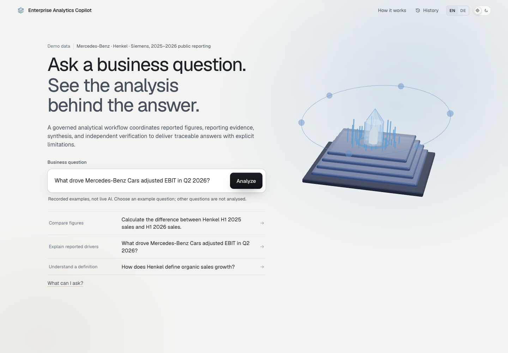

# Enterprise Analytics Copilot

**Business questions. Governed figures. Traceable answers.**

An analytics engineering and Applied AI application for investigating reported business performance. It combines governed KPI calculations, retrieval-augmented generation (RAG), traceable reporting evidence and controlled answer release. An implemented, opt-in **four-agent workflow** separates analytical investigation, evidence retrieval, synthesis and semantic review; the validated default remains a simpler governed workflow.



[Explore the existing Vercel demo](https://enterprise-analytics-copilot.vercel.app/) · [Architecture](docs/release_candidate_architecture.md) · [Release/deployment boundaries](docs/final_release_status.md)

The hosted interface is an interactive **recorded frontend replay**, not a live FastAPI/model deployment. Screenshots show that existing interface, not a newly validated live four-agent run.

Public-reporting datasets cover Mercedes-Benz, Henkel and Siemens. These companies are demo data subjects—not customers, partners or endorsements. Support varies by company, period, scope and metric.

## What you can investigate

Business users need more than a plausible explanation: the figure must use the right company, period and metric, and the explanation must be supported by reporting. The application addresses both requirements without giving a model authority over arithmetic or final release.

- Reported KPIs with exact units, periods and source lineage.
- Period comparisons and reported contribution bridges, subject to metric policy.
- Metric definitions and management explanations when approved documentary assets are available.
- Missing explanations, ambiguous questions and unsupported attribution, with explicit boundaries rather than invented drivers.

## Execution modes

| Path | Status | What it does |
|---|---|---|
| Default governed workflow | Existing validated path; unchanged by the new integration | Deterministic planning, calculations, retrieval and verification; synthesis is model-backed in the full local environment |
| Bounded four-role candidate | Opt-in development integration; not promoted | Model-backed analytics decisions, evidence decisions, synthesis and selective semantic review, under deterministic tool and release controls |
| Public Docker demo | Numerical-only, deterministic fake provider | Reproduces supported governed numerical answers without API credentials or the excluded documentary corpus |
| Existing Vercel frontend | Recorded example replay; no backend connection | Demonstrates the interface and evidence interactions without live analysis or provider requests |

The four-role candidate is implemented, but its final integrated live evaluation and promotion are pending. Multiple model-backed roles are not a claim of autonomous analysts or measured superiority. A single-controller implementation remains an evaluation baseline, not the selected product replacement.

## Four-agent architecture

| Role | Decision | Authority boundary |
|---|---|---|
| Analytics Agent | Selects from approved diagnostic actions when needed | Python performs arithmetic; the mandatory governed question anchor cannot be bypassed |
| Evidence Agent | Chooses from advertised scoped retrieval strategies and one permitted follow-up | No arbitrary SQL, web access, filter expansion or document instruction execution |
| Synthesis Agent | Selects documentary statements and bounded interpretation | Application owns numerical claims, calculation lineage and canonical quotations |
| Semantic Review Agent | Selectively checks semantic risk and bounded correction options | Does not execute repairs or authorize final release; deterministic code does |

Roles activate only when required. Numerical fast paths need not call a model. LangGraph carries typed state through planning, investigation, evidence assembly, synthesis, review and deterministic verification. A bounded revision may return to review; retries and tools remain capped. See [candidate architecture](docs/release_candidate_architecture.md).

## Engineering stack

Python · FastAPI · Pydantic · LangGraph · Decimal arithmetic · PostgreSQL/pgvector · cached SentenceTransformer MiniLM · React · TypeScript · Vite · Three.js.

The full authorized RAG path uses metadata-first MiniLM dense search in PostgreSQL/pgvector, top_k=5, with pinned source identities and no silent local fallback when pgvector is selected. BM25/hybrid are diagnostic/fallback capabilities, not the selected production default. The experimental policy applies bounded evidence-type preference and question-specific passage admission without relaxing company, period, scope or metric filters.

## Reliability and limitations

A relevant document is not necessarily a sufficient explanation. The candidate separately checks source integrity, requested entity/period/scope/metric, explanatory sufficiency and answer support. Mixed table/prose pages may supply valid prose without admitting every table. If only numerical findings are supported, the candidate can release a freshly verified **PARTIAL** answer.

Management attribution is not causal identification. A combined volume/structure/net-pricing bridge is not split into a fabricated price effect. Unsupported requests are withheld; unresolved questions may require clarification.

The bounded English extractive evidence policy can still fail on unseen semantics. Semantic Review adds a model-backed interpretation check; it does not replace source checks or the deterministic numerical release verifier.

## Validation evidence

| Checkpoint | Result | What it establishes |
|---|---|---|
| Public Python suite, 19 October 2026 | 194 passed, network blocked | Public contracts, governed analytics, presentation and API/schema compatibility |
| Public Docker compatibility checkpoint, 18 October 2026 | The same 194 tests passed; build/start/restart passed | Reproducibility of the numerical-only public demonstration |
| Frontend compatibility checkpoint, 18 October 2026 | 101 tests, TypeScript and production/recorded-demo builds passed | Frontend software checks, not complete accessibility or motion acceptance |
| Full local integration checkpoint, 17 October 2026 | 956 Python regressions and 91 policy/API checks passed | Engineering controls in the authorized local environment |
| Actual pgvector integration checkpoint | 12 pipeline executions and four HTTP API requests | Real database integration with cached MiniLM and **scripted model decisions**, not live-agent judgment |

Repeated runs are not additional independent tests, and the suites are not combined into an accuracy score. These results do not establish multi-agent superiority, general semantic reliability or production readiness. Final integrated live evaluation and independent human adjudication remain pending. Historical held results are preserved, not recertified as current performance. See [evaluation boundaries](docs/release_candidate_evaluation.md) and [historical public fixtures](docs/evaluation.md).

## Run the public demonstration

Prerequisites: Docker with Compose, a free local port 8000 and dependency-download access for a first build.

```sh
docker compose -f docker-compose.public.yml up --build
```

Open `http://localhost:8000`. Try “What were Henkel H1 2026 sales?” The governed figure is 10,348 EUR million. The demo uses a fake provider, makes no paid calls and intentionally refuses questions requiring excluded documentary reporting.

```sh
docker compose -f docker-compose.public.yml down
```

Do not use `down -v` against a database you need to preserve. Public-demo startup does not initialize a documentary pgvector store.

## Full local environment and tests

The full documentary path requires separately authorized source assets, ingestion/index initialization, cached MiniLM weights, PostgreSQL/pgvector and configured provider access. Raw reports, embeddings, runtime stores, provider transcripts and private evaluation artifacts are intentionally not redistributed. A public clone alone does not reproduce that path. Follow [reproduction](docs/reproduction.md), [deployment](docs/deployment.md), and [source/rights boundaries](docs/data_sources.md); never commit a populated environment file.

```sh
python -m pip install -r requirements-public.txt
python scripts/test_public.py
cd frontend
npm ci
npm test
npm run build
```

The private 956-regression and policy/API suite is not implied to be runnable from the public subset with excluded assets. There is no automatic environment switch promoting the candidate: the experimental API factory must be explicitly selected by application code with approved providers and retrievers.

## Demo and release status

The [demo guide](docs/release_candidate_demo.md) separates the existing Vercel replay, reproducible public numerical behavior, scripted engineering demonstrations and future approved live-agent demonstrations. Screenshots belong to the already published recorded-demo UI, not a newly validated live multi-agent run. [Dark theme](assets/screenshots/product-overview-dark.png) · [Supported figure](assets/screenshots/supported-analysis.png) · [Evidence inspector](assets/screenshots/evidence-inspector.png) · [Refusal](assets/screenshots/governed-refusal.png).

To reproduce the recorded interface locally:

```sh
cd frontend
npm ci
npm run build:demo
npm run preview
```

The source tree pins the patched transitive `source-map-js` dependency. The existing Vercel deployment is unchanged; dependency advisories and deployment boundaries are recorded in [release status](docs/final_release_status.md).

Remaining gates for live backend promotion: independent human adjudication, verified all-in billing, explicitly approved small live evaluation and product-level acceptance of the experimental mode. Session IDs are not authenticated tenant identities; this project is not cleared for public multi-tenant backend exposure. Source publication does not promote the experimental workflow or deploy a live backend.

Future work is deliberately narrow: complete those gates, validate semantic generalization and improve documentary readability without weakening numerical or release safeguards.

Independent portfolio project by Vaishnavi Iyer. See [ownership notice](LICENSE) and [third-party notices](THIRD_PARTY_NOTICES.md).
