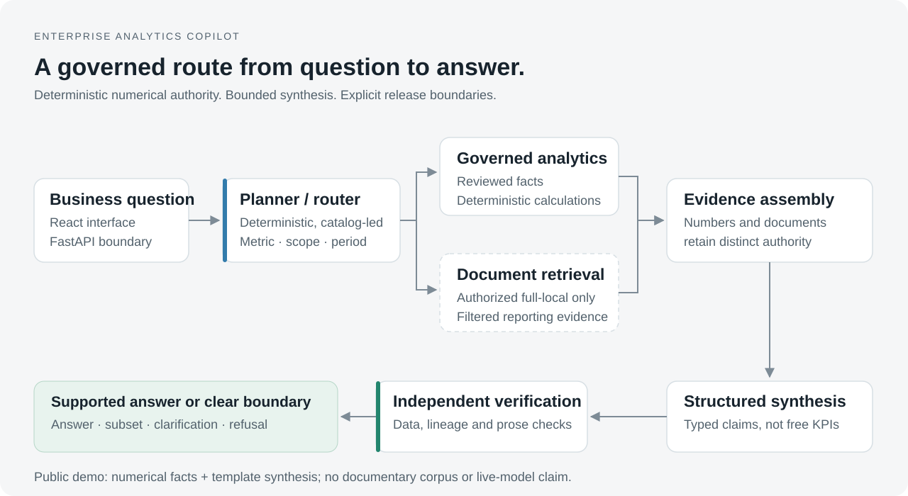
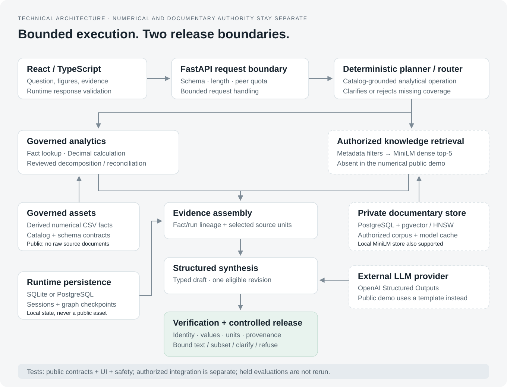

# Architecture

This page describes the unchanged default workflow. The separately opt-in,
model-backed four-role development integration is documented in
[candidate architecture](release_candidate_architecture.md); it is not the default.

The planner owns tool selection. Governed data and deterministic calculations
own numbers. Synthesis proposes structured claims; verification and release
logic decide what may be shown. This is a bounded analytical workflow, not a
swarm of autonomous agents.

## Technical view

Both diagrams are original, editable SVGs. They describe the default workflow;
the four-role candidate and its activation boundaries are documented separately.

| Component | Responsibility | Implementation |
|---|---|---|
| React interface | Question intake, result/evidence presentation, response validation | `frontend/src/` |
| FastAPI | Request validation, anonymous quota, bounded request handling, sessions | `src/api/` |
| Workflow Orchestrator (deterministic planning/routing) | Company, catalog metric, operation, scope, period and supported route | `src/planning/` and `src/orchestration/graph.py` |
| Analytics | Fact lookup, Decimal calculations, decomposition and controlled reconciliation | `src/analytics/` and `src/validation/` |
| Knowledge/retrieval | Metadata filtering and governed top-five documentary evidence | `src/retrieval/` |
| Evidence assembly | Separate numerical and documentary authority; retain selected lineage | `src/orchestration/graph.py` |
| Structured synthesis | Schema-constrained draft; one bounded revision when applicable | `src/llm/` and `src/orchestration/models.py` |
| Deterministic Release Verifier | Number/unit/identity/lineage/provenance/citation checks and conservative numerical prose checks | `src/orchestration/verifier.py` |
| Release boundary | Supported claims only; bound numeric rendering; clarification/refusal when required | `src/orchestration/graph.py` |

Original role templates in `prompts/` are published project source, not private
provider transcripts or hidden reasoning. Untrusted documentary content cannot
authorize tools or replace governed instructions. No chain-of-thought is exposed.

## Bounded-agent candidate (opt-in, not promoted)

`src/bounded_agents/` implements bounded Analytics, RAG Evidence, Insight Synthesis
and selective Semantic Review roles. Model-backed roles choose from application-
owned menus; governed tools execute calculations/retrieval, and the deterministic
release verifier retains final authority. The planner is still deterministic.
Multiple roles do not imply unconstrained autonomy or parallel execution.

The candidate is offline-tested, not the production default. Direct construction
of `BoundedAgentsGraph` defaults to `semantic-review-1`. The opt-in experimental
FastAPI factory in `src/bounded_agents/experimental_app.py` explicitly selects
`semantic-review-repair-options-2`; this does not change the default application.
Under that contract, claim corrections identify an existing disputed claim, while
documentary completion selects a validated, application-issued repair option.
Its component, source and execution anchor are resolved by application code.
Invalid, stale or incompatible targets fail closed. No arbitrary replacement
prose or release override is accepted.

One targeted live documentary-completion review selected the correct application
repair option. Offline completion checks passed; the overall result remained
PARTIAL because residual unapproved interpretation was withheld. A REVISE that
requests completion does not approve all retained interpretation. Release
accounting now distinguishes documentary subsets and records withheld identities
without recycling them. No safety exemption or extra review call was added.
Broader live fallback/end-to-end validation and human acceptance remain gates.
Private provider traces and intervention fixtures are not distributed.

### Actual candidate roles and activation

| Role | Bounded model decision | Application-owned execution |
|---|---|---|
| Analytics | One permitted diagnostic on eligible decomposition/explanation routes | Canonical question result always runs; Decimal arithmetic, ranking, reconciliation and lineage remain deterministic |
| RAG Evidence | One permitted strategy and optionally one precommitted different fallback | Metadata-pinned top-five search, identity checks and structural gap/follow-up admission |
| Insight Synthesis | Source IDs and limited optional interpretation | Exact source passages and all canonical numbers are rendered by code |
| Semantic Review | PASS / REVISE / BLOCK and one supported closed correction | Validate targets, apply repair, verify exact released content, or withhold |

These are four model-capable roles, not four guaranteed calls. Numeric lookups
and comparisons can use zero model calls. Knowledge questions can activate
Evidence and Synthesis, with Review only when policy requires it. Hybrid driver
questions can also activate Analytics. Rankings use deterministic selection;
clarification and unsupported questions short-circuit. Cached eligible evidence,
remaining budgets and canonical source-only content can skip roles.

The constructor accepts a provider; there are no four separately hard-coded
agent models or a promoted reviewer-only Sol default. The ordinary budgeted
adapter uses its explicitly supplied OpenAI model for its roles. Sol experiments
are scoped reviewer validations, not a deployed model routing policy.
The default FastAPI factory still builds `EnterpriseAnalyticsGraph`; v2 requires
an explicit request-scoped factory. Execution is serial and request-local, with
zero v2 retries, a 30-second default overall budget and at most one revision.
Review has a capped 12-second window and 224 output tokens. Timeouts prevent late
results from release but do not guarantee upstream cancellation or zero billing.

## Data and persistence

The public numerical authority is the reviewed CSV fact store, validated against
the metric catalog and Pydantic contracts. The normalized SQL schema defines and
tests the corresponding data contract; it is not a claim that every public
numeric request executes SQL against PostgreSQL.

Full-local semantic retrieval uses `sentence-transformers/all-MiniLM-L6-v2`,
metadata-first filtering, top-k five and cosine similarity. The wired Compose
runtime uses PostgreSQL/pgvector with HNSW; an authorized local MiniLM cosine
store is also supported. BM25 and RRF are diagnostics/fallback implementations,
not the current default semantic retrieval claim.

Checkpoint/session stores use SQLite in the numerical demo or PostgreSQL in the
private Compose topology. Their contents are runtime state and are not shipped.

## Execution modes

| Mode | Numerical data | Documentary data | Synthesis |
|---|---|---|---|
| Public Docker demo | Committed reviewed derived facts | Disabled; documentary questions refuse | Deterministic fake/template provider |
| Authorized full local | Same governed contracts | Locally acquired corpus and model cache, or pgvector | Configured OpenAI structured provider |
| Hosted Vercel frontend | Curated recorded examples | Selected illustrative citations | Recorded replay; no runtime inference |

The full local environment is not reproduced by a clone alone. External LLM
calls are outside numerical authority and outside public CI. [Deployment and
proxy assumptions](deployment.md) · [Reproduction](reproduction.md)
